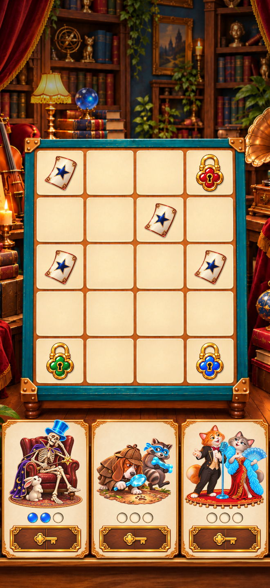
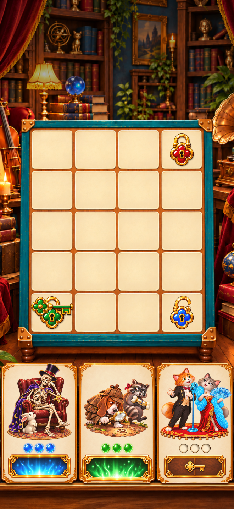

# Storage Auction 3
### Portrait merge prototype · Unity · Game Design

Combine matching items, complete character collections and use earned keys to reveal the next stage. A 4 × 5 board and three collection cards keep the next action and reward in view.

 

*Existing project captures illustrating the opening and a later collection state.*

## My contribution

Game design, gameplay logic, sketches and storyboards that formed the basis for the gameplay.

## Core loop

1. Drag equal items from the same chain together to upgrade them.
2. Deliver level-three items to the active collection.
3. Complete the collection to receive its key.
4. Drag the key onto its matching lock and continue to the next collection.
5. Complete all three collections to reach the final result.

The opening starts with part of the first collection already complete. Contextual hand hints demonstrate merges, delivery and key use during the first stage. Item flights, pulses and bursts reinforce successful actions.

## Open and play

- **Editor:** Unity **6000.6.3f1**, as recorded in `ProjectSettings/ProjectVersion.txt`.
- Add this repository folder in Unity Hub and allow packages and assets to import.
- Open `Assets/_Game/Scenes/StorageAuction3_PlayableAd.unity` and press Play.
- Use the mouse to drag items and keys; the project uses UI pointer events.
- Review in a portrait Game view; the layout uses a 1080 × 1920 reference.
- With Git LFS installed, run `git lfs pull` after cloning to retrieve source artwork.

## Design and source

[Design breakdown](docs/DESIGN.md)

| File | Purpose |
| --- | --- |
| `Assets/_Game/Scripts/MergeGameState.cs` | Merge, delivery, collection and unlock rules |
| `Assets/_Game/Scripts/MergeGameController.cs` | Input flow, hints, reward animation and end state |
| `Assets/_Game/Scripts/MergeDragSource.cs` | Pointer and drag handling |
| `Assets/_Game/Scripts/ResponsiveBoardBackground.cs` | Portrait board presentation |
| `Assets/WebGLTemplates/ItchPortrait` | Existing portrait WebGL template |
| `BuildTools` | Existing portrait build helper |

## Current status

Source and existing screenshots are included. This portfolio package was checked for source-copy integrity; gameplay and builds were not rerun during packaging. Android test builds exist in the original working project and are kept outside this source package. A hosted browser demo and advertising-network integration are not included.

## Credits

Design and contribution details are documented in [CREDITS.md](CREDITS.md). Existing in-project documentation is preserved; some older notes describe an earlier visual-only iteration. This README and the runtime source describe the gameplay version packaged here.
